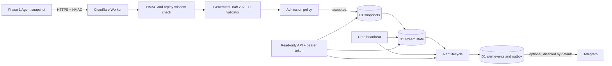
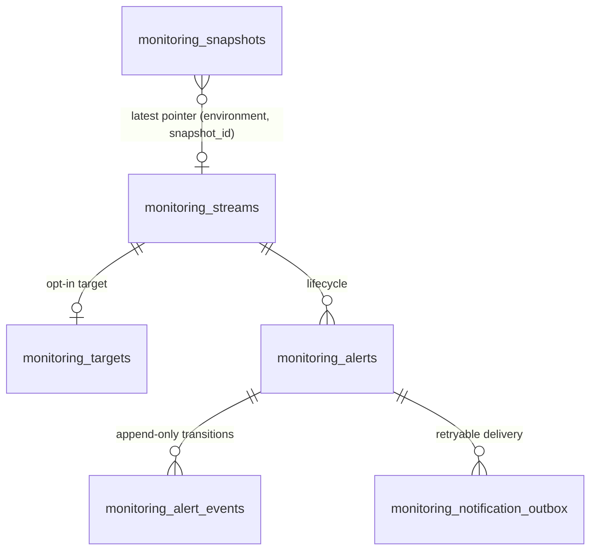
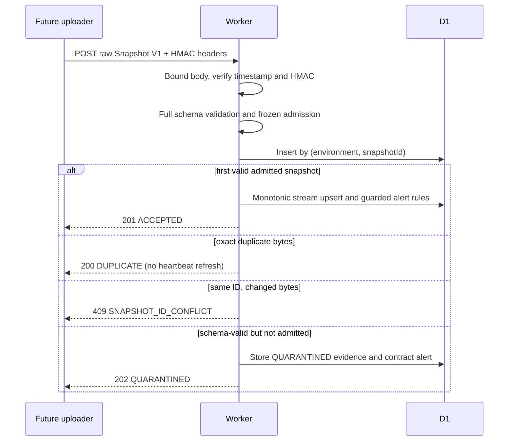

# Phase 2A — Cloudflare Monitoring Backend Architecture

## Scope and frozen input

This Worker is a monitoring control plane. Azure remains responsible for Open-Meteo, Kafka, Spark, Delta, XGBoost, and prospective evaluation. Phase 2A receives only the Phase 1 Monitoring Snapshot V1 contract; it does not deploy an uploader or connect to the live cohort.

The admission contract is pinned in `monitoring/cloudflare/src/config/contract.ts`: protocol `T2H_LIVE_PROSPECTIVE_168H_V1`, run `20261010T111433Z-prospective-live-t2h-v1`, cohort `prospective-t2h-20261010T120000Z`, T0 `2026-10-10T12:00:00Z`, end `2026-10-17T11:00:00Z`, 168 hours, 63 locations, 10,584 forecast slots, `ecmwf_ifs`, T+2H, and the frozen model/feature SHA-256 values. Admission does not use client claims as a substitute for the pinned model and cohort checks.

## Runtime and data flow

Hono routes are thin. Validation, admission, repositories, lifecycle services, and scheduled work are separate modules under `monitoring/cloudflare/src/`. Workers Web Crypto verifies exact raw-body signatures. Wrangler binds local/staging D1; migrations are versioned SQL. The test suite uses `@cloudflare/vitest-plugin` and Miniflare D1.

## Storage model

`monitoring_snapshots` keeps schema-valid accepted and quarantined payloads (maximum 32 KiB) and a SHA-256 hash. Unique `(environment, snapshot_id)` is the idempotency gate. `monitoring_streams` points only to the newest accepted collection timestamp; a late historical sample cannot replace a newer one, and only a fresh delivery advances `last_live_heartbeat_at`. `monitoring_targets` are disabled until explicitly enabled and activated. Alert state is deduplicated by fingerprint; events and notification delivery are separate records.

## Ingestion state flow

Collection freshness is derived from D1 receive time and `snapshot.timestamp`; a sample advances heartbeat only when delivery lag is nonnegative within clock tolerance, within the configured heartbeat timeout, and at most two expected intervals. Cron independently recomputes age against database time. `collector.PARTIAL`, pending T+2H references, and agent-reported `monitorFreshness` are not treated as proof of pipeline failure or Cloudflare arrival.

## Scheduled processing and alert state

`*/5 * * * *` runs heartbeat checks, repairs at most one snapshot inserted before a partial D1 failure, recovers at most one missing quarantine alert event, and retries at most one due notification. Any repair consumes that tick and defers the routine target scan until the next five-minute tick. Quality/watchdog/disk/collector rules run when a new accepted snapshot is applied, not again for unchanged current evidence. `17 3 * * *` removes bounded batches past retention. Alert transitions use conditional SQL and a unique active fingerprint. Unknown metrics leave existing alerts sticky. Heartbeat recovery requires a newly accepted fresh snapshot; a duplicate or historical retry cannot resolve it. Telegram stays disabled unless an operator sets the enable flag and secrets.

## Trust boundaries

- Ingestion is authenticated by an HMAC over the exact raw request body and a short-lived request timestamp.
- Source environment and hostname are allowlisted; frozen cohort/model fields are checked separately.
- Read endpoints use a bearer token that grants access to the whole monitoring inventory. It is for server-side operators/BFF only, never a browser bundle.
- `healthz` exposes liveness only. Request errors use request IDs and do not return SQL, stack traces, secrets, or payloads.
- No raw weather events, Kafka data, credentials, or Azure evidence are copied into Cloudflare.

## Limits and capacity

The API accepts at most 32 KiB per snapshot. At the hard cap and one snapshot every five minutes, one stream stores `288 × 14 × 32 KiB ≈ 126 MiB` of payload over 14 days, before SQLite row/index overhead. Sixty-three locations are represented inside one cohort snapshot and do not multiply this estimate. Actual usage must be measured from staging before enabling more streams.

As checked against Cloudflare's current official limits on 2026-10-13, Workers Free permits 100,000 requests/day, 10 ms CPU per HTTP request and Cron invocation, and five Cron Triggers per account. D1 Free permits 10 databases/account, 500 MB/database, 5 GB/account, and 50 D1 queries per Worker invocation; each SQL statement in a batch is subject to per-query limits. These ceilings make sustained use of 32 KiB snapshots, many enabled targets, or large notification backlogs unsuitable without measured CPU/query headroom. The Free-oriented config scans at most five enabled targets per heartbeat invocation and fails closed if more exist than the configured cap; one due Telegram outbox item is processed per Cron tick. Keep Free deployments at or below five enabled targets and measure CPU/query headroom before raising this limit on a paid account. The expected 63 locations are inside one snapshot stream, not 63 monitoring targets. [Workers limits](https://developers.cloudflare.com/workers/platform/limits/) · [D1 limits](https://developers.cloudflare.com/d1/platform/limits/).

## Limitations and Phase 2B dependencies

- The contract is deliberately pinned to the current frozen cohort. A later cohort requires a reviewed code change and contract-specific tests; runtime variables cannot override model, feature, provider, horizon, or T0.
- Monitoring target activation is an operator action and is not included in the ingestion API.
- The read token is a single admin credential; Phase 3 browser access needs Cloudflare Access/session auth or a server-side BFF.
- No Azure uploader, production/staging deployment, load test, or production alert policy is included in Phase 2A.
- Phase 2B must implement a durable local outbox, sign the exact UTF-8 JSON bytes, persist `snapshotId`, retry transient HTTP/network failures with bounded exponential backoff and jitter, avoid retrying permanent schema/auth errors, and preserve quarantined responses for operator review. Contract details and a cross-runtime HMAC vector are in `PHASE2B_INTEGRATION_CONTRACT.md`.
